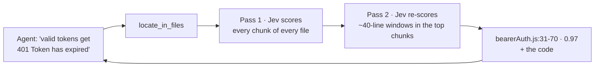

<div align="center">

# jev-offload-mcp

**Let your AI agent scan huge codebases for a fraction of a cent — without reading them.**

An [MCP](https://modelcontextprotocol.io) server that gives any coding agent — Claude Code, Claude Desktop, Cursor, VS Code, Codex, Windsurf — access to **[Jev](https://openrouter.ai/typesafe/jev-1.13)**, a tiny decision model on OpenRouter. The agent describes what it's looking for; Jev sifts through every line and points to the exact spot.

[](https://github.com/GorOhanyan/jev-offload-mcp/actions/workflows/ci.yml)


English · [Русский](README.ru.md)

</div>

---

## Why

Your agent needs to find a bug somewhere in 80 files. Reading them costs **~270k tokens** of its context. With this server it asks *"where does this happen?"* and gets back **~1k tokens**: the file, the line range, and the code. Then it reads and fixes just that — it's already an LLM, it doesn't need another one.

Jev doesn't write text. It **scores and picks**: yes/no with a probability, one of N options, a level on a scale. That's exactly what's needed to narrow down a search — and it costs **$0.042 per 1M input tokens, output free**.

## How it works



Nothing is truncated: large files are split into overlapping chunks and **all** of them are scored, so a bug in the middle of a 20k-line file is still found.

## Benchmarks

A bug was planted in the [MCP TypeScript SDK](https://github.com/modelcontextprotocol/typescript-sdk) sources (token-expiry comparison flipped on one line). Jev only got the symptom.

| Corpus | Result | Time | Cost |
|---|---|---|---|
| 88 files, ~270k tokens | #1: `bearerAuth.js:31-70`, p = 0.97 — the bug is on line 49 | 8 s | $0.012 |
| One 810 KB file, 19.5k lines, bug in the middle | #1: `all.js:11577-11616`, p = 0.97 — the bug is on line 11611 | 7 s | $0.012 |

## Tools

| Tool | What it does | Example |
|---|---|---|
| `locate_in_files` | Finds **where** something is: a bug from its symptoms, the code behind a feature, where a setting lives. Returns ranked `file:lines` with probabilities, a per-file ranking and the code of the top hits | *"valid tokens get 401 'Token has expired', expired ones pass"* |
| `classify_files` | Sorts every file into your labels with a confidence score | `test`, `config`, `dead-code: unused or unreachable`, `business-logic` |
| `decide_files` | Several typed questions per file: `yes_no`, `choice`, `score`. `only_matching` returns only files where a flag is *yes* | `uses_db` (yes/no), `layer` (api/domain/ui), `complexity` (low → high) |

Common parameters: `paths` (files and/or directories), `include` / `exclude` (globs), `respect_gitignore`, `model`, `dry_run` (show what would be scanned — no API calls).

<details>
<summary>Example output of <code>locate_in_files</code></summary>

```text
Most likely locations (probability · file:lines):
1. 0.97  server/auth/middleware/bearerAuth.js:31-70
2. 0.72  examples/server/demoInMemoryOAuthProvider.js:91-130
3. 0.62  examples/server/elicitationUrlExample.js:151-190

Files ranking:
1. 0.97  server/auth/middleware/bearerAuth.js
2. 0.68  examples/server/simpleStreamableHttp.js
3. 0.66  examples/server/elicitationUrlExample.js

--- server/auth/middleware/bearerAuth.js:31-70 (0.97)
...
45|             // Check if the token is set to expire or if it is expired
46|             if (typeof authInfo.expiresAt !== 'number' || isNaN(authInfo.expiresAt)) {
47|                 throw new InvalidTokenError('Token has no expiration time');
48|             }
49|             else if (authInfo.expiresAt > Date.now() / 1000) {
50|                 throw new InvalidTokenError('Token has expired');
51|             }
...

---
files: 88 | ~source tokens: 268700 | chunks: 108 | windows: 48 | jev calls: 156 | cost: $0.01175
```

</details>

## Install

You need **Node.js 18+** and a regular **OpenRouter API key** — [openrouter.ai/keys](https://openrouter.ai/keys) (a management/provisioning key won't work).

```bash
git clone https://github.com/GorOhanyan/jev-offload-mcp.git
cd jev-offload-mcp && npm install
```

Every config below runs `node /ABS/PATH/jev-offload-mcp/src/index.js`. Desktop apps often don't see your shell `PATH`, so use the absolute path to `node` (`which node`) if `node` alone doesn't start.

Or skip the clone and let npx fetch it from GitHub: use `"command": "npx"`, `"args": ["-y", "github:GorOhanyan/jev-offload-mcp"]`.

<details open>
<summary><b>Claude Code</b></summary>

```bash
claude mcp add jev --scope user -e OPENROUTER_API_KEY=sk-or-... -- node /ABS/PATH/jev-offload-mcp/src/index.js
```

</details>

<details>
<summary><b>Claude Desktop</b> — <code>claude_desktop_config.json</code></summary>

macOS: `~/Library/Application Support/Claude/claude_desktop_config.json` · Windows: `%APPDATA%\Claude\claude_desktop_config.json`

```json
{
  "mcpServers": {
    "jev": {
      "command": "node",
      "args": ["/ABS/PATH/jev-offload-mcp/src/index.js"],
      "env": { "OPENROUTER_API_KEY": "sk-or-..." }
    }
  }
}
```

</details>

<details>
<summary><b>Cursor</b> — <code>~/.cursor/mcp.json</code> or <code>.cursor/mcp.json</code></summary>

```json
{
  "mcpServers": {
    "jev": {
      "command": "node",
      "args": ["/ABS/PATH/jev-offload-mcp/src/index.js"],
      "env": { "OPENROUTER_API_KEY": "sk-or-..." }
    }
  }
}
```

Same format for **Windsurf** (`~/.codeium/windsurf/mcp_config.json`).

</details>

<details>
<summary><b>VS Code</b> — <code>.vscode/mcp.json</code></summary>

```json
{
  "inputs": [
    { "type": "promptString", "id": "openrouter-key", "description": "OpenRouter API key", "password": true }
  ],
  "servers": {
    "jev": {
      "type": "stdio",
      "command": "node",
      "args": ["/ABS/PATH/jev-offload-mcp/src/index.js"],
      "env": { "OPENROUTER_API_KEY": "${input:openrouter-key}" }
    }
  }
}
```

</details>

<details>
<summary><b>Codex</b> — <code>~/.codex/config.toml</code></summary>

```toml
[mcp_servers.jev]
command = "node"
args = ["/ABS/PATH/jev-offload-mcp/src/index.js"]
tool_timeout_sec = 300

[mcp_servers.jev.env]
OPENROUTER_API_KEY = "sk-or-..."
```

</details>

### Make the agent actually use it

The server ships MCP `instructions` telling the agent when to call it, but a line in `CLAUDE.md` / `AGENTS.md` / `.cursor/rules` makes it reliable:

```text
When you need to find something in a lot of code or text (a bug from its symptoms, where a feature
is implemented, where a setting lives) or triage many files — use the jev MCP first
(locate_in_files / classify_files / decide_files), then read only the lines it points to.
```

## Configuration

| Variable | Default | Description |
|---|---|---|
| `OPENROUTER_API_KEY` | — | **Required** |
| `JEV_MODEL` | `typesafe/jev-1.13` | Decision model on OpenRouter |
| `JEV_CONCURRENCY` | `8` | Parallel requests to Jev |
| `JEV_BASE_DIR` | workspace root from MCP roots, else cwd | What relative paths resolve against |
| `JEV_ALLOWED_ROOTS` | — | Restrict reading to these directories (`:`-separated) |
| `JEV_MAX_FILE_BYTES` / `JEV_MAX_FILES` | `1000000` / `2000` | Limits for file collection |
| `JEV_ALLOW_SECRETS` | — | `1` stops excluding `.env`, keys etc. (not recommended) |
| `JEV_DECISIONS_URL` | `https://openrouter.ai/api/alpha/decisions` | Decisions API endpoint |
| `JEV_TIMEOUT_MS` | `120000` | Per-request timeout |

## What never leaves your machine

`node_modules`, `.git`, `dist` / `build`, lock files, minified bundles, binaries, everything in `.gitignore`, and secrets — `.env*`, `*.pem`, `*.key`, `id_rsa*`, `credentials*`, `.npmrc`, `.aws/`, `.ssh/` and similar. Use `dry_run: true` to see exactly what would be sent.

## Development

```bash
npm install
npm test
```

The test is end-to-end: a real MCP client talks to the server over stdio while the Decisions API is mocked. It covers all three tools, dry runs, filters, secret / `.gitignore` / binary exclusion, a full scan of a large file with pinpointing to a line window, and workspace-root detection via MCP roots.

## License

[MIT](LICENSE) © Gor Ohanyan
