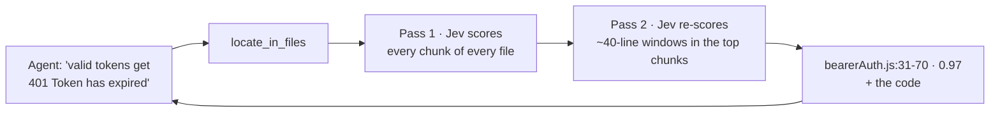

<div align="center">

# jev-offload-mcp

**Let your AI agent scan huge codebases for a fraction of a cent — without reading them.**

An [MCP](https://modelcontextprotocol.io) server that gives any coding agent — Claude Code, Claude Desktop, Cursor, VS Code, Codex, Windsurf — access to tiny **decision models** on OpenRouter: [Jev](https://openrouter.ai/typesafe/jev-1.13) by default, [Cloudflare Clef](https://openrouter.ai/cloudflare/clef), Mercury Decide, Liquid D1 and every other model behind the [Decisions API](https://openrouter.ai/docs). The agent describes what it's looking for; the model sifts through every line and points to the exact spot.

[](https://github.com/GorOhanyan/jev-offload-mcp/actions/workflows/ci.yml)


English · [Русский](README.ru.md)

</div>

---

## Why

Your agent needs to find a bug somewhere in 80 files. Reading them costs **~270k tokens** of its context. With this server it asks *"where does this happen?"* and gets back **~1k tokens**: the file, the line range, and the code. Then it reads and fixes just that — it's already an LLM, it doesn't need another one.

Decision models don't write text. They **score and pick**: yes/no with a probability, one of N options, a level on a scale. That's exactly what's needed to narrow down a search — and it costs **$0.02–0.05 per 1M input tokens, output free**.

## How it works



Nothing is truncated: large files are split into overlapping chunks and **all** of them are scored, so a bug in the middle of a 20k-line file is still found.

## Benchmarks

Measured on the compiled [MCP TypeScript SDK](https://github.com/modelcontextprotocol/typescript-sdk) 1.32.1 — 87 files, ~230k tokens — with ground truth that can be checked mechanically. Reproduce with `npm run bench`; raw results are in [`bench/results`](bench/results).

- **Bug** — 6 one-line bugs planted one at a time (inverted comparisons, an off-by-one, a wrong constant), in 6 different files. The model gets only the symptom, half of them in Russian. *file #1* — the buggy file ranks first; *line window #1* — the top ~40-line window contains the bug.
- **Facts** — 6 yes/no questions for every file (calls fetch, defines a class, throws, uses timers, uses zod, async), checked with regexes.
- **Classify** — client / server / shared / examples for 71 files, **with paths anonymized** so the model has to read the code.

| Model | Bug: file #1 | Bug: file top-3 | Bug: line window #1 | Bug: line top-3 | Facts acc | Facts F1 | Classify acc | Cost | Time |
|---|---|---|---|---|---|---|---|---|---|
| `inception/mercury-decide` | 6/6 | 6/6 | 6/6 | 6/6 | 99% | 0.96 | 85% | $0.0313 | 88s |
| `cloudflare/clef` | 6/6 | 6/6 | 6/6 | 6/6 | 99% | 0.97 | 83% | $0.0889 | 139s |
| `openai/gpt-6-luna-decisions` | 6/6 | 6/6 | 6/6 | 6/6 | 97% | 0.89 | 79% | $0.1760 | 47s |
| `perplexity/pplx-decider-v1.1-27b` | 6/6 | 6/6 | 5/6 | 6/6 | 99% | 0.97 | 85% | $0.0443 | 65s |
| `nace-ai/drex-v2.0` | 6/6 | 6/6 | 5/6 | 6/6 | 99% | 0.94 | 72% | $0.0907 | 63s |
| `liquid/d1` | 6/6 | 6/6 | 5/6 | 6/6 | 98% | 0.93 | 72% | $0.0436 | 54s |
| `typesafe/jev-1.13` | 6/6 | 6/6 | 4/6 | 5/6 | 98% | 0.91 | 87% | $0.0775 | 53s |
| `microsoft/microsoft-decision-1` | 6/6 | 6/6 | 4/6 | 5/6 | 99% | 0.96 | 80% | $0.0658 | 57s |
| `nace-ai/drex-v1.5` | 6/6 | 6/6 | 4/6 | 5/6 | 98% | 0.91 | 76% | $0.0597 | 59s |
| `cloudflare/clef-omni` | 6/6 | 6/6 | 3/6 | 5/6 | 99% | 0.97 | 75% | $0.2532 | 49s |
| `cloudflare/clef-flash` | 5/6 | 6/6 | 3/6 | 5/6 | 97% | 0.92 | 69% | $0.0425 | 75s |
| `togethercomputer/tev1-4b-experimental` | 4/6 | 4/6 | 3/6 | 4/6 | 99% | 0.96 | 73% | $0.0945 | 61s |
| `jaredpalmer/kev-4b` | 4/6 | 4/6 | 2/6 | 3/6 | 98% | 0.95 | 73% | $0.0639 | 134s |
| `scaledown/classify-1` | 4/6 | 5/6 | 1/6 | 3/6 | 98% | 0.96 | 66% | $0.0916 | 115s |
| `respan/span-01-lite` | 2/6 | 4/6 | 2/6 | 3/6 | 89% | 0.75 | n/a | $0.0000 | 57s |
| `upstage/solar-decide` | 1/6 | 3/6 | 1/6 | 2/6 | 94% | 0.88 | 69% | $0.1341 | 631s |
| `upstage/solar-decide-flash` | 1/6 | 2/6 | 1/6 | 1/6 | 90% | 0.83 | 66% | $0.1336 | 116s |

**Takeaways**

- Every top-10 model found the right file for all 6 bugs on the first try, out of 87 files.
- [`inception/mercury-decide`](https://openrouter.ai/inception/mercury-decide) is the best all-rounder and the cheapest model that handles every task: perfect bug localization, 0.96 facts F1, about $0.03 for the whole benchmark. [`cloudflare/clef`](https://openrouter.ai/cloudflare/clef) matches it on localization and ties for the best facts score. Jev 1.13 has the best classification accuracy.
- Small 4B models and the Upstage / Respan models are noticeably weaker at localization. Respan is an LLM-judge model and only supports yes/no questions.
- Runs vary a little: with 6 bugs, one window more or less moves *line #1* by a whole step. Treat differences of ±1 as noise.

## Tools

| Tool | What it does | Example |
|---|---|---|
| `locate_in_files` | Finds **where** something is: a bug from its symptoms, the code behind a feature, where a setting lives. Returns ranked `file:lines` with probabilities, a per-file ranking and the code of the top hits | *"valid tokens get 401 'Token has expired', expired ones pass"* |
| `classify_files` | Sorts every file into your labels with a confidence score | `test`, `config`, `dead-code: unused or unreachable`, `business-logic` |
| `decide_files` | Several typed questions per file: `yes_no`, `choice`, `score`. `only_matching` returns only files where a flag is *yes* | `uses_db` (yes/no), `layer` (api/domain/ui), `complexity` (low → high) |
| `list_models` | Decision models available on OpenRouter with context size and price; pass any id as `model` | `cloudflare/clef`, `inception/mercury-decide` |

Common parameters: `paths` (files and/or directories), `include` / `exclude` (globs), `respect_gitignore`, `model`, `dry_run` (show what would be scanned — no API calls).

<details>
<summary>Example output of <code>locate_in_files</code></summary>

```text
Most likely locations (probability · file:lines):
1. 0.97  server/auth/middleware/bearerAuth.js:31-70
2. 0.72  examples/server/demoInMemoryOAuthProvider.js:91-130
3. 0.62  examples/server/elicitationUrlExample.js:151-190

Files ranking:
1. 0.97  server/auth/middleware/bearerAuth.js
2. 0.68  examples/server/simpleStreamableHttp.js
3. 0.66  examples/server/elicitationUrlExample.js

--- server/auth/middleware/bearerAuth.js:31-70 (0.97)
...
45|             // Check if the token is set to expire or if it is expired
46|             if (typeof authInfo.expiresAt !== 'number' || isNaN(authInfo.expiresAt)) {
47|                 throw new InvalidTokenError('Token has no expiration time');
48|             }
49|             else if (authInfo.expiresAt > Date.now() / 1000) {
50|                 throw new InvalidTokenError('Token has expired');
51|             }
...

---
files: 88 | ~source tokens: 268700 | chunks: 108 | windows: 48 | jev calls: 156 | cost: $0.01175
```

</details>

## Any decision model

Every tool takes a `model` argument, and `JEV_MODEL` sets the default. The server adapts to each model automatically:

- **Context size** is read from OpenRouter's catalog, and chunks are sized to fit — from 8k-token models like `jaredpalmer/kev-4b` to 1M-token ones.
- **Request quirks** are learned from the first rejection and remembered: models that want `state` as a string (ScaleDown, Respan) or accept only yes/no questions with plain-string criteria (Respan) just work.
- **Fallbacks**: list backups in `JEV_FALLBACK_MODELS`, and they take over if the primary model fails.

## Install

You need **Node.js 18+** and a regular **OpenRouter API key** — [openrouter.ai/keys](https://openrouter.ai/keys) (a management/provisioning key won't work).

```bash
git clone https://github.com/GorOhanyan/jev-offload-mcp.git
cd jev-offload-mcp && npm install
```

Every config below runs `node /ABS/PATH/jev-offload-mcp/src/index.js`. Desktop apps often don't see your shell `PATH`, so use the absolute path to `node` (`which node`) if `node` alone doesn't start.

Or skip the clone and let npx fetch it from GitHub: use `"command": "npx"`, `"args": ["-y", "github:GorOhanyan/jev-offload-mcp"]`.

<details open>
<summary><b>Claude Code</b></summary>

```bash
claude mcp add jev --scope user -e OPENROUTER_API_KEY=sk-or-... -- node /ABS/PATH/jev-offload-mcp/src/index.js
```

</details>

<details>
<summary><b>Claude Desktop</b> — <code>claude_desktop_config.json</code></summary>

macOS: `~/Library/Application Support/Claude/claude_desktop_config.json` · Windows: `%APPDATA%\Claude\claude_desktop_config.json`

```json
{
  "mcpServers": {
    "jev": {
      "command": "node",
      "args": ["/ABS/PATH/jev-offload-mcp/src/index.js"],
      "env": { "OPENROUTER_API_KEY": "sk-or-..." }
    }
  }
}
```

</details>

<details>
<summary><b>Cursor</b> — <code>~/.cursor/mcp.json</code> or <code>.cursor/mcp.json</code></summary>

```json
{
  "mcpServers": {
    "jev": {
      "command": "node",
      "args": ["/ABS/PATH/jev-offload-mcp/src/index.js"],
      "env": { "OPENROUTER_API_KEY": "sk-or-..." }
    }
  }
}
```

Same format for **Windsurf** (`~/.codeium/windsurf/mcp_config.json`).

</details>

<details>
<summary><b>VS Code</b> — <code>.vscode/mcp.json</code></summary>

```json
{
  "inputs": [
    { "type": "promptString", "id": "openrouter-key", "description": "OpenRouter API key", "password": true }
  ],
  "servers": {
    "jev": {
      "type": "stdio",
      "command": "node",
      "args": ["/ABS/PATH/jev-offload-mcp/src/index.js"],
      "env": { "OPENROUTER_API_KEY": "${input:openrouter-key}" }
    }
  }
}
```

</details>

<details>
<summary><b>Codex</b> — <code>~/.codex/config.toml</code></summary>

```toml
[mcp_servers.jev]
command = "node"
args = ["/ABS/PATH/jev-offload-mcp/src/index.js"]
tool_timeout_sec = 300

[mcp_servers.jev.env]
OPENROUTER_API_KEY = "sk-or-..."
```

</details>

### Make the agent actually use it

The server ships MCP `instructions` telling the agent when to call it, but a line in `CLAUDE.md` / `AGENTS.md` / `.cursor/rules` makes it reliable:

```text
When you need to find something in a lot of code or text (a bug from its symptoms, where a feature
is implemented, where a setting lives) or triage many files — use the jev MCP first
(locate_in_files / classify_files / decide_files), then read only the lines it points to.
```

## Configuration

| Variable | Default | Description |
|---|---|---|
| `OPENROUTER_API_KEY` | — | **Required** |
| `JEV_MODEL` | `typesafe/jev-1.13` | Default decision model (any id from `list_models`) |
| `JEV_FALLBACK_MODELS` | — | Comma-separated backups tried in order if the primary fails |
| `JEV_CONCURRENCY` | `8` | Parallel requests to Jev |
| `JEV_BASE_DIR` | workspace root from MCP roots, else cwd | What relative paths resolve against |
| `JEV_ALLOWED_ROOTS` | — | Restrict reading to these directories (`:`-separated) |
| `JEV_MAX_FILE_BYTES` / `JEV_MAX_FILES` | `1000000` / `2000` | Limits for file collection |
| `JEV_ALLOW_SECRETS` | — | `1` stops excluding `.env`, keys etc. (not recommended) |
| `JEV_DECISIONS_URL` | `https://openrouter.ai/api/alpha/decisions` | Decisions API endpoint |
| `JEV_MODELS_URL` | OpenRouter decision-model catalog | Where context sizes and prices are read from |
| `JEV_TIMEOUT_MS` | `120000` | Per-request timeout |

## What never leaves your machine

`node_modules`, `.git`, `dist` / `build`, lock files, minified bundles, binaries, everything in `.gitignore`, and secrets — `.env*`, `*.pem`, `*.key`, `id_rsa*`, `credentials*`, `.npmrc`, `.aws/`, `.ssh/` and similar. Use `dry_run: true` to see exactly what would be sent.

## Development

```bash
npm install
npm test
```

The test is end-to-end: a real MCP client talks to the server over stdio while the Decisions API is mocked. It covers every tool, dry runs, filters, secret / `.gitignore` / binary exclusion, a full scan of a large file with pinpointing to a line window, context-aware chunk sizing, per-model request adaptation, fallback models and workspace-root detection via MCP roots.

`npm run bench` runs the quality benchmark against the real API (needs `OPENROUTER_API_KEY`; about $1–2 for all models).

## License

[MIT](LICENSE) © Gor Ohanyan
