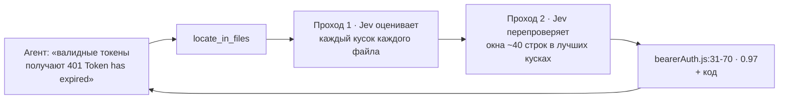

<div align="center">

# decisions-mcp

**ИИ-агент просматривает огромные кодовые базы за доли цента — не читая их сам.**

[MCP](https://modelcontextprotocol.io)-сервер, который даёт любому агенту — Claude Code, Claude Desktop, Cursor, VS Code, Codex, Windsurf — доступ к маленьким **decision-моделям** на OpenRouter: по умолчанию [Jev](https://openrouter.ai/typesafe/jev-1.13), а также [Cloudflare Clef](https://openrouter.ai/cloudflare/clef), Mercury Decide, Liquid D1 и любая другая модель Decisions API. Агент описывает, что ищет; модель просеивает каждую строку и указывает точное место.

[](https://github.com/GorOhanyan/decisions-mcp/actions/workflows/ci.yml)


[English](README.md) · Русский

</div>

---

## Зачем

Агенту нужно найти баг где-то в 80 файлах. Прочитать их — **~270k токенов** его контекста. С этим сервером он спрашивает *«где это происходит?»* и получает **~1k токенов**: файл, диапазон строк и сам код. Дальше читает и чинит только это — он и так LLM, вторая модель ему не нужна.

Decision-модели не пишут текст. Они **оценивают и выбирают**: да/нет с вероятностью, один из вариантов, уровень по шкале. Ровно это и нужно, чтобы сузить поиск, — и стоит это **$0.02–0.05 за 1M входных токенов, выход бесплатный**.

## Как это работает



Ничего не обрезается: большие файлы режутся на куски с перекрытием, и оцениваются **все** — баг в середине файла на 20 тысяч строк тоже найдётся.

## Замеры

Замерено на скомпилированном [MCP TypeScript SDK](https://github.com/modelcontextprotocol/typescript-sdk) 1.32.1 — 87 файлов, ~230k токенов — с эталоном, который проверяется автоматически. Повторить: `npm run bench`; сырые результаты — в [`bench/results`](bench/results).

- **Bug** — 6 однострочных багов, подложенных по одному (перевёрнутые сравнения, сдвиг на единицу, неверная константа) в 6 разных файлах. Модель получает только симптом, половина — на русском. *file #1* — файл с багом на первом месте; *line window #1* — баг в лучшем окне из ~40 строк.
- **Facts** — 6 вопросов да/нет про каждый файл (вызывает fetch, объявляет класс, бросает ошибки, таймеры, zod, async), проверка регулярками.
- **Classify** — client / server / shared / examples для 71 файла, **пути обезличены**, чтобы модель читала код, а не имя папки.

| Model | Bug: file #1 | Bug: file top-3 | Bug: line window #1 | Bug: line top-3 | Facts acc | Facts F1 | Classify acc | Cost | Time |
|---|---|---|---|---|---|---|---|---|---|
| `inception/mercury-decide` | 6/6 | 6/6 | 6/6 | 6/6 | 99% | 0.96 | 85% | $0.0313 | 88s |
| `cloudflare/clef` | 6/6 | 6/6 | 6/6 | 6/6 | 99% | 0.97 | 83% | $0.0889 | 139s |
| `openai/gpt-6-luna-decisions` | 6/6 | 6/6 | 6/6 | 6/6 | 97% | 0.89 | 79% | $0.1760 | 47s |
| `perplexity/pplx-decider-v1.1-27b` | 6/6 | 6/6 | 5/6 | 6/6 | 99% | 0.97 | 85% | $0.0443 | 65s |
| `nace-ai/drex-v2.0` | 6/6 | 6/6 | 5/6 | 6/6 | 99% | 0.94 | 72% | $0.0907 | 63s |
| `liquid/d1` | 6/6 | 6/6 | 5/6 | 6/6 | 98% | 0.93 | 72% | $0.0436 | 54s |
| `typesafe/jev-1.13` | 6/6 | 6/6 | 4/6 | 5/6 | 98% | 0.91 | 87% | $0.0775 | 53s |
| `microsoft/microsoft-decision-1` | 6/6 | 6/6 | 4/6 | 5/6 | 99% | 0.96 | 80% | $0.0658 | 57s |
| `nace-ai/drex-v1.5` | 6/6 | 6/6 | 4/6 | 5/6 | 98% | 0.91 | 76% | $0.0597 | 59s |
| `cloudflare/clef-omni` | 6/6 | 6/6 | 3/6 | 5/6 | 99% | 0.97 | 75% | $0.2532 | 49s |
| `cloudflare/clef-flash` | 5/6 | 6/6 | 3/6 | 5/6 | 97% | 0.92 | 69% | $0.0425 | 75s |
| `togethercomputer/tev1-4b-experimental` | 4/6 | 4/6 | 3/6 | 4/6 | 99% | 0.96 | 73% | $0.0945 | 61s |
| `jaredpalmer/kev-4b` | 4/6 | 4/6 | 2/6 | 3/6 | 98% | 0.95 | 73% | $0.0639 | 134s |
| `scaledown/classify-1` | 4/6 | 5/6 | 1/6 | 3/6 | 98% | 0.96 | 66% | $0.0916 | 115s |
| `respan/span-01-lite` | 2/6 | 4/6 | 2/6 | 3/6 | 89% | 0.75 | n/a | $0.0000 | 57s |
| `upstage/solar-decide` | 1/6 | 3/6 | 1/6 | 2/6 | 94% | 0.88 | 69% | $0.1341 | 631s |
| `upstage/solar-decide-flash` | 1/6 | 2/6 | 1/6 | 1/6 | 90% | 0.83 | 66% | $0.1336 | 116s |

**Выводы**

- Все модели из первой десятки нашли нужный файл для всех 6 багов с первого места среди 87 файлов.
- [`inception/mercury-decide`](https://openrouter.ai/inception/mercury-decide) — лучшая в целом и самая дешёвая среди моделей, которые справляются со всеми задачами: идеальный поиск багов, F1 по фактам 0.96, около $0.03 за весь замер. [`cloudflare/clef`](https://openrouter.ai/cloudflare/clef) не уступает в поиске и делит первое место по фактам. Jev 1.13 точнее всех в классификации.
- Маленькие 4B-модели, Upstage и Respan заметно слабее в поиске. Respan — модель-судья для LLM, поддерживает только вопросы да/нет.
- Есть разброс между прогонами: на 6 багах одно окно больше или меньше сдвигает *line #1* на целый шаг. Разницу ±1 считайте шумом.

## Инструменты

| Инструмент | Что делает | Пример |
|---|---|---|
| `locate_in_files` | Ищет, **где** находится описанное: баг по симптомам, код фичи, место настройки. Возвращает `файл:строки` с вероятностями, рейтинг файлов и код топ-мест | *«валидные токены получают 401 'Token has expired', а просроченные проходят»* |
| `classify_files` | Раскладывает каждый файл по вашим меткам с уверенностью | `test`, `config`, `dead-code: неиспользуемый код`, `business-logic` |
| `decide_files` | Несколько типизированных вопросов про каждый файл: `yes_no`, `choice`, `score`. `only_matching` — только файлы с «да» | `uses_db` (да/нет), `layer` (api/domain/ui), `complexity` (low → high) |
| `list_models` | Decision-модели на OpenRouter с размером контекста и ценой; любой id можно передать как `model` | `cloudflare/clef`, `inception/mercury-decide` |

Общие параметры: `paths` (файлы и/или каталоги), `include` / `exclude` (glob), `respect_gitignore`, `model`, `dry_run` (показать, что будет просканировано, без запросов к API).

## Любая decision-модель

У каждого инструмента есть аргумент `model`, а `DECISIONS_MODEL` задаёт модель по умолчанию. Сервер сам подстраивается под модель:

- **Размер контекста** берётся из каталога OpenRouter, куски режутся под него — от моделей на 8k токенов вроде `jaredpalmer/kev-4b` до моделей на 1M.
- **Особенности API** запоминаются после первого отказа: модели, которым нужен `state` строкой (ScaleDown, Respan) или только вопросы да/нет со строковыми критериями (Respan), работают без настройки.
- **Резервные модели**: перечислите их в `DECISIONS_FALLBACK_MODELS` — они подхватят, если основная модель упала.

## Установка

Нужны **Node.js 18+** и обычный **API-ключ OpenRouter** — [openrouter.ai/keys](https://openrouter.ai/keys) (management/provisioning-ключ не подойдёт).

```bash
git clone https://github.com/GorOhanyan/decisions-mcp.git
cd decisions-mcp && npm install
```

Во всех конфигах ниже запускается `node /ABS/PATH/decisions-mcp/src/index.js`. Десктопные приложения часто не видят `PATH` из терминала — если просто `node` не стартует, укажите абсолютный путь (`which node`).

Или без клонирования, через npx прямо с GitHub: `"command": "npx"`, `"args": ["-y", "github:GorOhanyan/decisions-mcp"]`.

<details open>
<summary><b>Claude Code</b></summary>

```bash
claude mcp add decisions --scope user -e OPENROUTER_API_KEY=sk-or-... -- node /ABS/PATH/decisions-mcp/src/index.js
```

</details>

<details>
<summary><b>Claude Desktop</b> — <code>claude_desktop_config.json</code></summary>

macOS: `~/Library/Application Support/Claude/claude_desktop_config.json` · Windows: `%APPDATA%\Claude\claude_desktop_config.json`

```json
{
  "mcpServers": {
    "decisions": {
      "command": "node",
      "args": ["/ABS/PATH/decisions-mcp/src/index.js"],
      "env": { "OPENROUTER_API_KEY": "sk-or-..." }
    }
  }
}
```

</details>

<details>
<summary><b>Cursor</b> — <code>~/.cursor/mcp.json</code> или <code>.cursor/mcp.json</code></summary>

```json
{
  "mcpServers": {
    "decisions": {
      "command": "node",
      "args": ["/ABS/PATH/decisions-mcp/src/index.js"],
      "env": { "OPENROUTER_API_KEY": "sk-or-..." }
    }
  }
}
```

Тот же формат у **Windsurf** (`~/.codeium/windsurf/mcp_config.json`).

</details>

<details>
<summary><b>VS Code</b> — <code>.vscode/mcp.json</code></summary>

```json
{
  "inputs": [
    { "type": "promptString", "id": "openrouter-key", "description": "OpenRouter API key", "password": true }
  ],
  "servers": {
    "decisions": {
      "type": "stdio",
      "command": "node",
      "args": ["/ABS/PATH/decisions-mcp/src/index.js"],
      "env": { "OPENROUTER_API_KEY": "${input:openrouter-key}" }
    }
  }
}
```

</details>

<details>
<summary><b>Codex</b> — <code>~/.codex/config.toml</code></summary>

```toml
[mcp_servers.decisions]
command = "node"
args = ["/ABS/PATH/decisions-mcp/src/index.js"]
tool_timeout_sec = 300

[mcp_servers.decisions.env]
OPENROUTER_API_KEY = "sk-or-..."
```

</details>

### Чтобы агент реально им пользовался

Сервер сам передаёт агенту MCP-`instructions`, но строка в `CLAUDE.md` / `AGENTS.md` / `.cursor/rules` делает это надёжным:

```text
Если нужно найти что-то в большом объёме кода/текста (баг по симптомам, где реализована фича,
где настройка) или разобрать много файлов — сначала используй MCP decisions
(locate_in_files / classify_files / decide_files), потом читай только строки, на которые он указал.
```

## Настройки

Старые имена `JEV_*` (проект раньше назывался jev-offload-mcp) по-прежнему работают.

| Переменная | По умолчанию | Описание |
|---|---|---|
| `OPENROUTER_API_KEY` | — | **Обязательно** |
| `DECISIONS_MODEL` | `typesafe/jev-1.13` | Модель по умолчанию (любой id из `list_models`) |
| `DECISIONS_FALLBACK_MODELS` | — | Резервные модели через запятую, пробуются по очереди |
| `DECISIONS_CONCURRENCY` | `8` | Параллельных запросов к Jev |
| `DECISIONS_BASE_DIR` | корень воркспейса из MCP roots, иначе cwd | От чего считать относительные пути |
| `DECISIONS_ALLOWED_ROOTS` | — | Ограничить чтение этими каталогами (через `:`) |
| `DECISIONS_MAX_FILE_BYTES` / `DECISIONS_MAX_FILES` | `1000000` / `2000` | Лимиты на сбор файлов |
| `DECISIONS_ALLOW_SECRETS` | — | `1` — не исключать `.env`, ключи и т.п. (не рекомендуется) |
| `DECISIONS_DECISIONS_URL` | `https://openrouter.ai/api/alpha/decisions` | Endpoint Decisions API |
| `DECISIONS_MODELS_URL` | каталог decision-моделей OpenRouter | Откуда берутся размеры контекста и цены |
| `DECISIONS_TIMEOUT_MS` | `120000` | Таймаут одного запроса |

## Что никогда не уходит с машины

`node_modules`, `.git`, `dist` / `build`, lock-файлы, минифицированные бандлы, бинарники, всё из `.gitignore` и секреты — `.env*`, `*.pem`, `*.key`, `id_rsa*`, `credentials*`, `.npmrc`, `.aws/`, `.ssh/` и т.п. `dry_run: true` покажет, что именно будет отправлено.

## Разработка

```bash
npm install
npm test
```

Тест сквозной: настоящий MCP-клиент общается с сервером по stdio, Decisions API заменён моком. Покрывает все инструменты, dry run, фильтры, исключение секретов / `.gitignore` / бинарников, полный скан большого файла с уточнением до окна строк, размер кусков под контекст модели, подстройку запроса под модель, резервные модели и определение корня через MCP roots.

`npm run bench` — замер качества на реальном API (нужен `OPENROUTER_API_KEY`; около $1–2 за все модели).

## Лицензия

[MIT](LICENSE) © Gor Ohanyan
