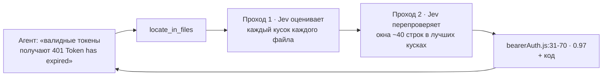

<div align="center">

# jev-offload-mcp

**ИИ-агент просматривает огромные кодовые базы за доли цента — не читая их сам.**

[MCP](https://modelcontextprotocol.io)-сервер, который даёт любому агенту — Claude Code, Claude Desktop, Cursor, VS Code, Codex, Windsurf — доступ к **[Jev](https://openrouter.ai/typesafe/jev-1.13)**, маленькой decision-модели на OpenRouter. Агент описывает, что ищет; Jev просеивает каждую строку и указывает точное место.

[](https://github.com/GorOhanyan/jev-offload-mcp/actions/workflows/ci.yml)


[English](README.md) · Русский

</div>

---

## Зачем

Агенту нужно найти баг где-то в 80 файлах. Прочитать их — **~270k токенов** его контекста. С этим сервером он спрашивает *«где это происходит?»* и получает **~1k токенов**: файл, диапазон строк и сам код. Дальше читает и чинит только это — он и так LLM, вторая модель ему не нужна.

Jev не пишет текст. Он **оценивает и выбирает**: да/нет с вероятностью, один из вариантов, уровень по шкале. Ровно это и нужно, чтобы сузить поиск, — и стоит это **$0.042 за 1M входных токенов, выход бесплатный**.

## Как это работает



Ничего не обрезается: большие файлы режутся на куски с перекрытием, и оцениваются **все** — баг в середине файла на 20 тысяч строк тоже найдётся.

## Замеры

В исходники [MCP TypeScript SDK](https://github.com/modelcontextprotocol/typescript-sdk) подложен баг (в одной строке перевёрнуто сравнение срока токена). Jev получил только описание симптома.

| Корпус | Результат | Время | Цена |
|---|---|---|---|
| 88 файлов, ~270k токенов | 1-е место: `bearerAuth.js:31-70`, p = 0.97 — баг на строке 49 | 8 с | $0.012 |
| Один файл 810 КБ, 19.5k строк, баг в середине | 1-е место: `all.js:11577-11616`, p = 0.97 — баг на строке 11611 | 7 с | $0.012 |

## Инструменты

| Инструмент | Что делает | Пример |
|---|---|---|
| `locate_in_files` | Ищет, **где** находится описанное: баг по симптомам, код фичи, место настройки. Возвращает `файл:строки` с вероятностями, рейтинг файлов и код топ-мест | *«валидные токены получают 401 'Token has expired', а просроченные проходят»* |
| `classify_files` | Раскладывает каждый файл по вашим меткам с уверенностью | `test`, `config`, `dead-code: неиспользуемый код`, `business-logic` |
| `decide_files` | Несколько типизированных вопросов про каждый файл: `yes_no`, `choice`, `score`. `only_matching` — только файлы с «да» | `uses_db` (да/нет), `layer` (api/domain/ui), `complexity` (low → high) |

Общие параметры: `paths` (файлы и/или каталоги), `include` / `exclude` (glob), `respect_gitignore`, `model`, `dry_run` (показать, что будет просканировано, без запросов к API).

## Установка

Нужны **Node.js 18+** и обычный **API-ключ OpenRouter** — [openrouter.ai/keys](https://openrouter.ai/keys) (management/provisioning-ключ не подойдёт).

```bash
git clone https://github.com/GorOhanyan/jev-offload-mcp.git
cd jev-offload-mcp && npm install
```

Во всех конфигах ниже запускается `node /ABS/PATH/jev-offload-mcp/src/index.js`. Десктопные приложения часто не видят `PATH` из терминала — если просто `node` не стартует, укажите абсолютный путь (`which node`).

Или без клонирования, через npx прямо с GitHub: `"command": "npx"`, `"args": ["-y", "github:GorOhanyan/jev-offload-mcp"]`.

<details open>
<summary><b>Claude Code</b></summary>

```bash
claude mcp add jev --scope user -e OPENROUTER_API_KEY=sk-or-... -- node /ABS/PATH/jev-offload-mcp/src/index.js
```

</details>

<details>
<summary><b>Claude Desktop</b> — <code>claude_desktop_config.json</code></summary>

macOS: `~/Library/Application Support/Claude/claude_desktop_config.json` · Windows: `%APPDATA%\Claude\claude_desktop_config.json`

```json
{
  "mcpServers": {
    "jev": {
      "command": "node",
      "args": ["/ABS/PATH/jev-offload-mcp/src/index.js"],
      "env": { "OPENROUTER_API_KEY": "sk-or-..." }
    }
  }
}
```

</details>

<details>
<summary><b>Cursor</b> — <code>~/.cursor/mcp.json</code> или <code>.cursor/mcp.json</code></summary>

```json
{
  "mcpServers": {
    "jev": {
      "command": "node",
      "args": ["/ABS/PATH/jev-offload-mcp/src/index.js"],
      "env": { "OPENROUTER_API_KEY": "sk-or-..." }
    }
  }
}
```

Тот же формат у **Windsurf** (`~/.codeium/windsurf/mcp_config.json`).

</details>

<details>
<summary><b>VS Code</b> — <code>.vscode/mcp.json</code></summary>

```json
{
  "inputs": [
    { "type": "promptString", "id": "openrouter-key", "description": "OpenRouter API key", "password": true }
  ],
  "servers": {
    "jev": {
      "type": "stdio",
      "command": "node",
      "args": ["/ABS/PATH/jev-offload-mcp/src/index.js"],
      "env": { "OPENROUTER_API_KEY": "${input:openrouter-key}" }
    }
  }
}
```

</details>

<details>
<summary><b>Codex</b> — <code>~/.codex/config.toml</code></summary>

```toml
[mcp_servers.jev]
command = "node"
args = ["/ABS/PATH/jev-offload-mcp/src/index.js"]
tool_timeout_sec = 300

[mcp_servers.jev.env]
OPENROUTER_API_KEY = "sk-or-..."
```

</details>

### Чтобы агент реально им пользовался

Сервер сам передаёт агенту MCP-`instructions`, но строка в `CLAUDE.md` / `AGENTS.md` / `.cursor/rules` делает это надёжным:

```text
Если нужно найти что-то в большом объёме кода/текста (баг по симптомам, где реализована фича,
где настройка) или разобрать много файлов — сначала используй MCP jev
(locate_in_files / classify_files / decide_files), потом читай только строки, на которые он указал.
```

## Настройки

| Переменная | По умолчанию | Описание |
|---|---|---|
| `OPENROUTER_API_KEY` | — | **Обязательно** |
| `JEV_MODEL` | `typesafe/jev-1.13` | Decision-модель на OpenRouter |
| `JEV_CONCURRENCY` | `8` | Параллельных запросов к Jev |
| `JEV_BASE_DIR` | корень воркспейса из MCP roots, иначе cwd | От чего считать относительные пути |
| `JEV_ALLOWED_ROOTS` | — | Ограничить чтение этими каталогами (через `:`) |
| `JEV_MAX_FILE_BYTES` / `JEV_MAX_FILES` | `1000000` / `2000` | Лимиты на сбор файлов |
| `JEV_ALLOW_SECRETS` | — | `1` — не исключать `.env`, ключи и т.п. (не рекомендуется) |
| `JEV_DECISIONS_URL` | `https://openrouter.ai/api/alpha/decisions` | Endpoint Decisions API |
| `JEV_TIMEOUT_MS` | `120000` | Таймаут одного запроса |

## Что никогда не уходит с машины

`node_modules`, `.git`, `dist` / `build`, lock-файлы, минифицированные бандлы, бинарники, всё из `.gitignore` и секреты — `.env*`, `*.pem`, `*.key`, `id_rsa*`, `credentials*`, `.npmrc`, `.aws/`, `.ssh/` и т.п. `dry_run: true` покажет, что именно будет отправлено.

## Разработка

```bash
npm install
npm test
```

Тест сквозной: настоящий MCP-клиент общается с сервером по stdio, Decisions API заменён моком. Покрывает все три инструмента, dry run, фильтры, исключение секретов / `.gitignore` / бинарников, полный скан большого файла с уточнением до окна строк и определение корня через MCP roots.

## Лицензия

[MIT](LICENSE) © Gor Ohanyan
